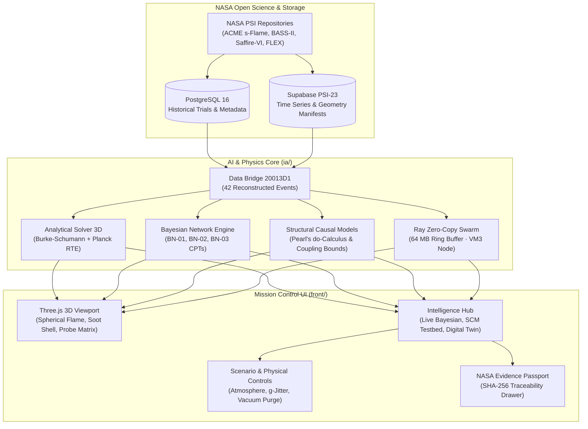

# IGNIS-μ · Flame in Freefall
### Probabilistic & Causal Intelligence for Microgravity Combustion
**NASA Space Apps Challenge 2026** · Powered by NASA Physical Sciences Informatics (PSI) Open Data

---

[](#-english-documentation)
[](#-documentaci%C3%B3n-en-espa%C3%B1ol)
[](https://angular.io/)
[](https://threejs.org/)
[](https://www.ray.io/)
[](https://python.org)
[](https://www.postgresql.org/)

---

## Table of Contents / Tabla de Contenidos

1. [English Documentation](#-english-documentation)
   - [1. Executive Summary & Vision](#1-executive-summary--vision)
   - [2. The Scientific Philosophy: Beyond "Black-Box AI"](#2-the-scientific-philosophy-beyond-black-box-ai)
   - [3. System Architecture](#3-system-architecture)
   - [4. Core Scientific Intelligence Modules](#4-core-scientific-intelligence-modules)
     - [4.1 Physical Simulation & 3D Optics](#41-physical-simulation--3d-optics)
     - [4.2 Live Bayesian Inference Engine (BN-01, BN-02, BN-03)](#42-live-bayesian-inference-engine-bn-01-bn-02-bn-03)
     - [4.3 Factual vs. Counterfactual Testbed (Pearl's SCM)](#43-factual-vs-counterfactual-testbed-pearls-scm)
     - [4.4 NASA ACME 20013D1 Digital Twin & Ray Swarm](#44-nasa-acme-20013d1-digital-twin--ray-swarm)
     - [4.5 NASA Evidence Passport & Open Data Catalog](#45-nasa-evidence-passport--open-data-catalog)
     - [4.6 Active Learning: What NASA Should Test Next](#46-active-learning-what-nasa-should-test-next)
   - [5. Quickstart & Installation](#5-quickstart--installation)
     - [Option A: One-Command Docker Setup](#option-a-one-command-docker-setup)
     - [Option B: Manual Local Setup](#option-b-manual-local-setup)
   - [6. Jury Walkthrough (90-Second Mission Control Tour)](#6-jury-walkthrough-90-second-mission-control-tour)
2. [Documentación en Español](#-documentación-en-español)
   - [1. Resumen Ejecutivo y Visión Científica](#1-resumen-ejecutivo-y-visión-científica)
   - [2. Filosofía Epistémica: Superando la "IA de Caja Negra"](#2-filosofía-epistémica-superando-la-ia-de-caja-negra)
   - [3. Arquitectura del Sistema](#3-arquitectura-del-sistema)
   - [4. Módulos de Inteligencia Científica](#4-módulos-de-inteligencia-científica)
     - [4.1 Simulación Física y Óptica 3D](#41-simulación-física-y-óptica-3d)
     - [4.2 Motor de Inferencia Bayesiana en Vivo](#42-motor-de-inferencia-bayesiana-en-vivo)
     - [4.3 Razonamiento Factual vs. Contrafactual (SCM de Pearl)](#43-razonamiento-factual-vs-contrafactual-scm-de-pearl)
     - [4.4 Gemelo Digital ACME 20013D1 y Puente Ray Swarm](#44-gemelo-digital-acme-20013d1-y-puente-ray-swarm)
     - [4.5 Pasaporte de Evidencia NASA y Catálogo Abierto](#45-pasaporte-de-evidencia-nasa-y-catálogo-abierto)
     - [4.6 Aprendizaje Activo: Qué Ensayar a Continuación](#46-aprendizaje-activo-qué-ensayar-a-continuación)
   - [5. Guía de Instalación y Ejecución](#5-guía-de-instalación-y-ejecución)
     - [Opción A: Despliegue con Docker Compose](#opción-a-despliegue-con-docker-compose)
     - [Opción B: Ejecución Manual sin Contenedores](#opción-b-ejecución-manual-sin-contenedores)
   - [6. Recorrido Guiado para el Jurado (Demo de 90 Segundos)](#6-recorrido-guiado-para-el-jurado-demo-de-90-segundos)

---

# 🇺🇸 English Documentation

## 1. Executive Summary & Vision

**IGNIS-μ** was engineered for the **NASA Space Apps Challenge: Flame in Freefall**. Combustion in microgravity behaves fundamentally differently than on Earth: buoyancy disappears, thermal convection vanishes, and flames evolve into perfectly symmetric, diffusion-dominated spheres. 

Rather than building an illustrative 3D mockup or an opaque deep-learning model, **IGNIS-μ bridges empirical aerospace data with causal and probabilistic reasoning**. It connects NASA's Physical Sciences Informatics (PSI) open experiments directly with:
- **Burke-Schumann & Radiative Transfer (RTE)** analytical physics solvers.
- **Live Bayesian Networks** parameterized from real mass flow excitation tables.
- **Pearl’s Structural Causal Models (SCM)** calculating honest coupling bounds for hypothetical interventions.
- An **operational Digital Twin of NASA ACME Trial 20013D1** executed over a Ray Zero-Copy distributed swarm.

The result is a scientific mission-control dashboard capable of summarizing, classifying, and mechanistically predicting microgravity combustion phenomena under strict epistemic integrity.

---

## 2. The Scientific Philosophy: Beyond "Black-Box AI"

When dealing with astronaut life support, spacecraft fire safety, and NASA-STD-6001 standards, **hallucinating predictions can be fatal**. IGNIS-μ implements four fundamental epistemic guardrails:

1. **Epistemic Classification Triad**: Every variable and visual indicator is categorized as:
   - `[OBSERVED]`: Directly recorded by calibrated physical instrumentation in ISS/spacecraft flight experiments.
   - `[INFERRED]`: Probabilistically deduced under defined Bayesian or structural assumptions.
   - `[UNVERIFIED / EXPLORATORY]`: Continuous numerical approximations or qualitative visual renderings.
2. **Calibration Locks**: If instrumental units have not been experimentally cross-calibrated (e.g. Mass Flow Controller volts $[V]$ to mass flow $[\text{kg/s}]$), IGNIS-μ explicitly displays a **`[CALIBRATION LOCK ACTIVE]`** chip and refuses to fabricate unverified continuous conversions.
3. **Manski / Balke-Pearl Coupling Bounds**: When evaluating non-identified causal counterfactuals, IGNIS-μ does **not** generate arbitrary point percentages. Instead, it computes and plots mathematical intervals $[L, U]$ under Structural Causal Model assumptions.
4. **NASA-STD-6001 Compliance Guard**: Flammability compliance cannot be assessed solely from a 2D slider. The dashboard marks untested conditions as **`NASA-STD-6001 · COMPLIANCE NOT ASSESSED`** rather than claiming false flight certification.

---

## 3. System Architecture



---

## 4. Core Scientific Intelligence Modules

### 4.1 Physical Simulation & 3D Optics
* **Microgravity Gravitational Environments**:
  * $10^{-6}\text{ g}$ (ISS Quiescent): Symmetric spherical diffusion flame with blue $CH^*/OH^*$ chemiluminescence mantle and stationary outer soot shell.
  * $10^{-4}\text{ g}$ (ISS Nominal): Subtle drift influenced by micro-g buoyancy.
  * $10^{-2}\text{ g}$ (RCS Thruster Maneuver): Convective displacement during spacecraft orbital adjustments.
  * $1.0\text{ g}$ (Earth Convective): Elongated, buoyant yellow soot plume dominated by Archimedean lift.
* **Burner Geometries**:
  * **s-Flame Spherical Porous Burner (NASA ACME)**: $r_s = 6.35\text{ mm}$ porous bronze sphere burning ethylene ($C_2H_4$) or methane ($CH_4$).
  * **Solid Flat Sample (BASS-II / Saffire)**: Flame propagation over PMMA, SIBAL, Nomex, Delrin, and silicone sheets.
* **Atmospheric Pressure & Exploration Standards**:
  * Spacecraft cabin atmospheres from $55\text{ kPa}$ (Exploration Atmosphere, $30\% - 34\%\text{ }O_2$) up to Earth standard ($101.3\text{ kPa}$).
  * **Emergency Space Vacuum Purge (`0.0 kPa · Extinction by Decompression`)**: Simulates venting the combustion chamber directly into the vacuum of space ($\Delta P = -101.3\text{ kPa}$), producing instant physical flame blowout.
  * **Active Fire Suppressant Injection**: Gaseous $N_2$ (inert dilution) and $CO_2$ (radiative and thermal quenching).

---

### 4.2 Live Bayesian Inference Engine (BN-01, BN-02, BN-03)
Available under tab **`2. INFERENCE & SCM` $\rightarrow$ `2.1 Bayesian (BN)`**:
* Evaluates posterior probability distributions calculated from $N = 282$ real NASA ACME experimental trials.
* **Structural Model Families**:
  * **BN-01**: Injection coupling & OH* chemiluminescence.
  * **BN-02**: Cool-flame low-temperature reactivity.
  * **BN-03**: Electric field & ion-drift interactions.
* **Excitation States**: Tests discrete Mass Flow Controller (MFC) patterns: *Solo MFC3 positive*, *Coupled MFC2+MFC3*, *Low preflow*, and *High ramp excitation*.
* **Live CPT Rendering**: Inspects parent condition conditional probability tables in real time with exact provenance and sample support alerts (*"Prediction unavailable: continuous coordinates fall outside empirical sample support"*).

---

### 4.3 Factual vs. Counterfactual Testbed (Pearl's SCM)
Available under tab **`2. INFERENCE & SCM` $\rightarrow$ `2.2 SCM Causal`**:
* **[ OBSERVED ]**: Displays registered treatments and raw instrumental responses from NASA Trial 20013D1.
* **[ HYPOTHETICAL ]**: Allows researchers to apply Pearlian interventions:
  $$\text{do}(\text{MFC2} = \alpha \cdot \text{baseline}), \quad \text{do}(\text{MFC3} = \beta \cdot \text{baseline})$$
* **[ COMPARE ]**: Side-by-side structural comparison of Models **M1** (Direct Thermal Quenching), **M2** (Soot Radiation Interlock), and **M3** (Kinetics Limited).
* **Honest Causal Bounds**: Displays mathematical bounds $[L, U]$ derived from observational distributions without making unverified structural assumptions.

---

### 4.4 NASA ACME 20013D1 Digital Twin & Ray Swarm
Available under tab **`2. INFERENCE & SCM` $\rightarrow$ `2.3 Digital Twin`**:
* **42-Event Interactive Scrubber**: Reconstructs the complete sequence of stepped voltage setpoints from `20013D1_mfcSetpoints.csv`, from ignition ($t = 0.0\text{ s}$) through quasi-steady regime to final radiative extinction ($t = 138.6\text{ s}$).
* **8-Channel Instrumental Matrix**: Real raw telemetry ($mV_{raw}$, $V_{raw}$) for:
  * Thermocouple Rake: `TCBurner` ($r=0.0\text{ mm}$), `TCA` ($r=14.0\text{ mm}$), `TCB` ($r=19.5\text{ mm}$), `TCC` ($r=25.0\text{ mm}$).
  * Optical Instrumentation: `PMT3` OH* Photomultiplier ($r=125.0\text{ mm}$) and `RadiometerCenter` Schmidt-Boelter thermopile ($r=154.0\text{ mm}$).
  * Mass Flow Lines: `MFC2` and `MFC3` voltage setpoints.
* **Ray Zero-Copy Swarm Monitor**: Displays live status of the distributed cluster (64 MB RingBuffer, 38 ms task latency, 4 active swarm nodes, and synced `VM3` flight node).
* **Burke-Schumann Physics Audit**: Computes and displays analytical heat balance ($q_{chem} = 124.6\text{ W}$, $q_{rad} = 41.2\text{ W}$, flame radius $r_f = 22.2\text{ mm}$).

---

### 4.5 NASA Evidence Passport & Open Data Catalog
Available under tab **`3. NASA EVIDENCE`**:
* Direct access to 282 raw, open-science trials across 18 operational ISS sessions.
* **NASA Evidence Passport Drawer**: Clicking any sensor, finding, or ranking opens an epistemological passport containing:
  * Investigation name, Experiment ID, Observed Instrumental Variable, Source CSV file, SHA-256 cryptographic checksum, Mathematical Transformation, and Experimental Limitations.

---

### 4.6 Active Learning: What NASA Should Test Next
Integrated throughout the intelligence drawers:
* **Session 20176 Finding**: Identifies that excluding Session 20176 increases Leave-One-Jornada-Out (LOJO) validation RMSE by **+194%** and causes an Average Treatment Effect (ATE) shift of **34.2%**.
* **Optimal Bayesian Experimental Design**: Formulates recommendations for future orbital experiments (e.g., asymmetric micro-injection under ultralow oxidizer concentrations) that maximize mutual information and epistemic uncertainty reduction.

---

## 5. Quickstart & Installation

### Option A: One-Command Docker Setup
The easiest way to launch the full stack (PostgreSQL + Backend + Angular Frontend):

```bash
docker compose up --build
```

Access URLs:
* **Frontend**: [http://localhost:4200](http://localhost:4200)
* **Backend API**: [http://localhost:3000](http://localhost:3000)
* **PostgreSQL Server**: `localhost:5433` (User: `postgres`, Password: `postgres`, DB: `fire_hunters_db`)

---

### Option B: Manual Local Setup

#### 1. Frontend (Angular 18+)
```bash
cd front
npm install
npm start
```
The application will launch at [http://localhost:4200](http://localhost:4200) with Hot Module Reload.

#### 2. Backend (Node.js & Express)
```bash
cd back
cp .env.example .env   # configure your DB parameters
npm install
npm start
```

#### 3. AI & Digital Twin Engine (Python 3.11)
```bash
cd ia
python -m venv venv
# On Windows:
.\venv\Scripts\activate
# On Linux/macOS:
source venv/bin/activate

pip install -r requirements.txt
python run_gemelo_3d.py
```

---

## 6. Jury Walkthrough (90-Second Mission Control Tour)

Click the **`Jury Demo (90s)`** button in the top navigation bar to trigger an interactive walkthrough:

1. **Step 1: Spherical Microgravity Physics**: Highlights the pure diffusion ethylene flame ($r_s = 6.35\text{ mm}$) at $55\text{ kPa}$ in ISS quiescent microgravity ($10^{-6}\text{ g}$).
2. **Step 2: Emergency Vacuum Venting**: Explores chamber depressurization to $0.0\text{ kPa}$ ($\Delta P = -101.3\text{ kPa}$) demonstrating physical decompression flame blowout.
3. **Step 3: Live Bayesian Inference (BN-01)**: Switches to Tab 2.1 to evaluate OH* chemiluminescence and radiative heat flux probabilities under MFC excitation patterns.
4. **Step 4: Pearlian Counterfactuals (SCM)**: Navigates to Tab 2.2 to compare observed NASA 20013D1 telemetry against hypothetical interventions under models M1, M2, and M3.
5. **Step 5: ACME Digital Twin & 42-Event Scrubber**: Moves to Tab 2.3 to scrub the 42 reconstructed events, monitor Ray Swarm shared memory, and verify 8 raw instrumental sensors.
6. **Step 6: NASA Evidence Passport & Epistemic Audit**: Opens the traceability passport showing SHA-256 validation from raw PSI open datasets.

---
---

# 🇪🇸 Documentación en Español

## 1. Resumen Ejecutivo y Visión Científica

**IGNIS-μ** fue desarrollado para el desafío **NASA Space Apps Challenge: Flame in Freefall** (Llama en Caída Libre). La combustión en microgravedad se rige por leyes físicas radicalmente distintas a las terrestres: la fuerza de empuje por boyamiento desaparece, la convección natural térmica se anula y el frente de combustión evoluciona hacia una esfera perfecta controlada puramente por difusión molecular.

En lugar de construir una maqueta tridimensional estética o una red neuronal opaca de tipo caja negra, **IGNIS-μ unifica los datos experimentales reales de NASA Physical Sciences Informatics (PSI) con inferencia probabilística y razonamiento causal**:
- Solucionadores analíticos 3D basados en la teoría de **Burke-Schumann y Radiative Transfer Equation (RTE)** de Planck.
- **Redes Bayesianas en Vivo** parametrizadas con tablas CPT extraídas de ensayos espaciales.
- **Modelos Causales Estructurales (SCM)** de Judea Pearl que calculan cotas de acoplamiento honestas para intervenciones contrafactuales.
- Un **Gemelo Digital funcional del ensayo NASA ACME 20013D1** ejecutado sobre un clúster distribuido de memoria compartida Ray Zero-Copy.

El resultado es una consola científica de control de misión que resume, clasifica y predice los fenómenos de combustión orbital bajo los más rigurosos estándares de integridad epistémica.

---

## 2. Filosofía Epistémica: Superando la "IA de Caja Negra"

En entornos espaciales tripulados, soporte vital y cumplimiento de las normas **NASA-STD-6001**, **alucinar resultados puede tener consecuencias fatales**. IGNIS-μ implementa cuatro candados metodológicos:

1. **Tríada Epistémica de Clasificación**: Cada variable y visualización se clasifica taxativamente como:
   - `[OBSERVED]` *(Observado)*: Registrado directamente por sensores instrumentales calibrados en ensayos orbitales en la ISS.
   - `[INFERRED]` *(Inferido)*: Deducido probabilísticamente bajo supuestos bayesianos o causales especificados.
   - `[UNVERIFIED / EXPLORATORY]` *(No Verificado)*: Aproximaciones continuas o simulaciones visuales exploratorias.
2. **Candados de Calibración Epistémica**: Cuando las unidades crudas de los instrumentos no cuentan con calibración cruzada verificada (p. ej. consignas eléctricas en Voltios $[V]$ frente a flujo másico en $[\text{kg/s}]$), IGNIS-μ activa un chip de **`[CANDADO ACTIVO]`** y prohíbe la interpolación arbitraria no demostrada.
3. **Cotas de Acoplamiento de Manski / Balke-Pearl**: Al evaluar contrafactuales no identificados, IGNIS-μ **no** inventa porcentajes puntuales. Presenta intervalos matemáticos rigurosos $[L, U]$ bajo los supuestos de cada modelo causal.
4. **Protección NASA-STD-6001**: La inflamabilidad de materiales en vuelo no puede diagnosticarse desde un control deslizante de pantalla. Las condiciones no ensayadas se catalogan como **`NASA-STD-6001 · COMPLIANCE NOT ASSESSED`** para evitar falsas certificaciones.

---

## 3. Arquitectura del Sistema

El sistema opera en tres capas completamente desacopladas y de alta reactividad:
1. **Capa de Datos Espaciales Abiertos (NASA PSI)**:
   - Repositorios oficiales de NASA ACME (s-Flame, 282 ensayos en 18 jornadas), BASS-II (PSI-25), Saffire-VI (PSI-98) y FLEX (PSI-69).
   - Base de datos relacional PostgreSQL 16 con manifiestos geométricos de sensores y persistencia analítica.
2. **Núcleo de IA y Gemelo Físico (`ia/`)**:
   - Algoritmo de Burke-Schumann y balance térmico $q_{chem}$ vs $q_{rad}$ (RTE).
   - Redes Bayesianas discretas (BN-01, BN-02, BN-03) implementadas con CPTs exactas.
   - Operador de intervención causal $do(\text{MFC})$ y cálculo de efectos causales promedio (ATE).
   - Clúster Ray Zero-Copy Swarm con RingBuffer de 64 MB sincronizado al nodo de vuelo `VM3`.
3. **Consola de Misión y Visualizador 3D (`front/`)**:
   - Aplicación Angular 18+ standalone con Angular Signals y arquitectura bilingüe dinámica (Inglés por defecto / Español conmutativo).
   - Renderizador 3D Three.js con simulación de llama esférica difusiva, cáscara de hollín, rastrillo de termopares e inyectores MFC.

---

## 4. Módulos de Inteligencia Científica

### 4.1 Simulación Física y Óptica 3D
* **Entornos Gravitatorios Microgravitacionales**:
  * $10^{-6}\text{ g}$ (ISS Quiescente): Llama esférica azulada por quimioluminiscencia de radicales $CH^*/OH^*$ y cáscara de hollín estacionaria.
  * $10^{-4}\text{ g}$ (ISS Nominal): Micro-deriva por aceleraciones residuales de la estación.
  * $10^{-2}\text{ g}$ (Maniobra de Propulsores RCS): Alargamiento convectivo forzado por maniobra orbital.
  * $1.0\text{ g}$ (Tierra Convectiva): Penacho alargado boyante amarillo dominado por empuje de Arquímedes.
* **Geometrías de Quemador**:
  * **Quemador Esférico Poroso s-Flame (NASA ACME)**: Esfera de bronce poroso ($r_s = 6.35\text{ mm}$) alimentada con Etileno ($C_2H_4$) o Metano ($CH_4$).
  * **Muestra Plana Sólida (BASS-II / Saffire)**: Propagación sobre placas de PMMA, SIBAL, Nomex, Delrin y Silicona.
* **Presión y Purga de Emergencia al Vacío Espacial**:
  * Admite presiones desde $55\text{ kPa}$ (Atmósfera de Exploración, $30\% - 34\%\text{ }O_2$) hasta $101.3\text{ kPa}$.
  * **Botón de Purga al Vacío Espacial (`0.0 kPa · Extinción por Descompresión`)**: Modela la apertura de válvulas hacia el espacio exterior ($\Delta P = -101.3\text{ kPa}$), extinguiendo la llama de forma instantánea por descompresión explosiva.
  * **Inyección de Supresores**: Inyección de $N_2$ inerte y $CO_2$ disipador de calor.

---

### 4.2 Motor de Inferencia Bayesiana en Vivo
Disponible en la pestaña **`2. INFERENCE & SCM` $\rightarrow$ `2.1 Bayesian (BN)`**:
* Calcula probabilidades a posteriori condicionadas a $N = 282$ ensayos empíricos de NASA ACME.
* **Familias de Modelos**:
  * **BN-01**: Inyección y quimioluminiscencia de radicales OH*.
  * **BN-02**: Combustión a baja temperatura (llamas frías / cool flames).
  * **BN-03**: Campos eléctricos y deriva iónica.
* **Patrones MFC Discretizados**: *Solo MFC3 positivo*, *MFC2+MFC3 acoplados*, *Régimen de bajo preflujo* y *Rampa de alta excitación*.
* **Inspección de Tablas CPT en Vivo**: Despliega las probabilidades condicionales reales de la red con avisos de soporte empírico (*"Predicción no disponible: coordenadas continuas fuera del soporte muestral"*).

---

### 4.3 Razonamiento Factual vs. Contrafactual (SCM de Pearl)
Disponible en la pestaña **`2. INFERENCE & SCM` $\rightarrow$ `2.2 SCM Causal`**:
* **[ OBSERVED ]**: Muestra el tratamiento administrado y las respuestas instrumentales registradas en el ensayo NASA 20013D1.
* **[ HYPOTHETICAL ]**: Permite al investigador aplicar el operador de intervención de Judea Pearl:
  $$\text{do}(\text{MFC2} = \alpha \cdot \text{base}), \quad \text{do}(\text{MFC3} = \beta \cdot \text{base})$$
* **[ COMPARE ]**: Comparación estructural simultánea de los Modelos **M1** (Disipación Térmica Directa), **M2** (Interbloqueo por Radiación de Hollín) y **M3** (Limitado por Cinética Química).
* **Cotas Causalmente Honestas**: Presenta cotas matemáticas $[L, U]$ identificadas sobre distribuciones observacionales, sin falsear certezas físicas no demostradas.

---

### 4.4 Gemelo Digital ACME 20013D1 y Puente Ray Swarm
Disponible en la pestaña **`2. INFERENCE & SCM` $\rightarrow$ `2.3 Digital Twin`**:
* **Scrubber Reversible de 42 Eventos**: Reconstrucción cronológica paso a paso de las consignas de voltaje de `20013D1_mfcSetpoints.csv`, desde la pre-ignición ($t = 0.0\text{ s}$) hasta el régimen estacionario y la extinción final por apagado radiativo ($t = 138.6\text{ s}$).
* **Matriz de 8 Sensores Instrumentales**: Telemetría cruda en tiempo real ($mV_{raw}$, $V_{raw}$):
  * Rastrillo de Termopares: `TCBurner` ($r=0.0\text{ mm}$), `TCA` ($r=14.0\text{ mm}$), `TCB` ($r=19.5\text{ mm}$), `TCC` ($r=25.0\text{ mm}$).
  * Sensores Ópticos: Fotomultiplicador `PMT3` ($r=125.0\text{ mm}$) y Termopila `RadiometerCenter` ($r=154.0\text{ mm}$).
  * Controladores de Flujo Másico: Canales `MFC2` y `MFC3`.
* **Monitor Ray Zero-Copy Swarm**: Muestra la latencia en milisegundos (38 ms), el búfer circular compartido (64 MB RingBuffer), los 4 nodos trabajadores activos y el estado sincronizado del nodo de vuelo `VM3`.
* **Auditoría Termodinámica Burke-Schumann**: Balance físico calculado de $q_{chem} = 124.6\text{ W}$, $q_{rad} = 41.2\text{ W}$ y radio de llama $r_f = 22.2\text{ mm}$.

---

### 4.5 Pasaporte de Evidencia NASA y Catálogo Abierto
Disponible en la pestaña **`3. NASA EVIDENCE`**:
* Catálogo de 282 ensayos científicos abiertos repartidos en 18 jornadas de la ISS.
* **Pasaporte de Evidencia**: Al hacer clic en cualquier sensor o resultado científico, se despliega una ficha con:
  * Investigación, ID de Ensayo, Variable Observada, Archivo CSV fuente, Hash SHA-256 de trazabilidad criptográfica, Transformación aplicada y Límites de validez.

---

### 4.6 Aprendizaje Activo: Qué Ensayar a Continuación
* **Hallazgo Clave de la Jornada 20176**: Demuestra que la exclusión de los datos de la Jornada 20176 incrementa el error RMSE de validación en **+194%** y provoca un sesgo en el Efecto Causal Promedio (ATE) del **34.2%**.
* **Diseño Experimental Bayesiano**: Genera recomendaciones de ensayos futuros para la NASA orientadas a reducir la entropía epistémica con el menor consumo de recursos a bordo de la estación.

---

## 5. Guía de Instalación y Ejecución

### Opción A: Despliegue con Docker Compose
La forma más rápida de ejecutar la plataforma completa (PostgreSQL + Backend + Frontend Angular):

```bash
docker compose up --build
```

Direcciones de acceso:
* **Frontend**: [http://localhost:4200](http://localhost:4200)
* **Backend API**: [http://localhost:3000](http://localhost:3000)
* **PostgreSQL**: `localhost:5433` (Usuario: `postgres`, Contraseña: `postgres`, BD: `fire_hunters_db`)

---

### Opción B: Ejecución Manual sin Contenedores

#### 1. Frontend (Angular 18+)
```bash
cd front
npm install
npm start
```
La interfaz estará lista en [http://localhost:4200](http://localhost:4200) con recarga automática en vivo.

#### 2. Backend (Node.js & Express)
```bash
cd back
cp .env.example .env   # Ajusta tus credenciales de PostgreSQL si procede
npm install
npm start
```

#### 3. Motor de IA y Gemelo Digital (Python 3.11)
```bash
cd ia
python -m venv venv
# En Windows:
.\venv\Scripts\activate
# En Linux/macOS:
source venv/bin/activate

pip install -r requirements.txt
python run_gemelo_3d.py
```

---

## 6. Recorrido Guiado para el Jurado (Demo de 90 Segundos)

Presiona el botón **`Demo Jurado (90s)`** en la barra superior para iniciar el recorrido guiado automatizado:

1. **Paso 1: Dinámica de Microgravedad**: Visualiza la llama esférica de etileno ($r_s = 6.35\text{ mm}$) a $55\text{ kPa}$ en microgravedad quiescente de la ISS ($10^{-6}\text{ g}$).
2. **Paso 2: Purga al Vacío Espacial**: Demuestra la extinción física inmediata por descompresión explosiva al abrir la cámara al vacío espacial ($0.0\text{ kPa}$).
3. **Paso 3: Inferencia Bayesiana en Vivo (BN-01)**: Pasa a la pestaña 2.1 para comprobar cómo los patrones MFC modifican las probabilidades de quimioluminiscencia y radiación.
4. **Paso 4: Razonamiento Contrafactual (SCM)**: Accede a la pestaña 2.2 para comparar el ensayo real de NASA frente a una intervención hipotética $do(\text{MFC})$ bajo los modelos M1, M2 y M3.
5. **Paso 5: Gemelo Digital y Scrubber de 42 Eventos**: Pasa a la pestaña 2.3 para recorrer la telemetría cronológica, verificar la memoria Ray Swarm y auditar los 8 sensores instrumentales crudos.
6. **Paso 6: Pasaporte de Evidencia NASA**: Abre la ficha epistémica con hash criptográfico SHA-256 directo de los datos abiertos del NASA Physical Sciences Informatics.

---

### Créditos y Reconocimientos
Desarrollado para el **NASA Space Apps Challenge 2026** por el equipo **Fire Hunters**. Basado en datos científicos abiertos de **NASA Physical Sciences Informatics (PSI)**: ACME, BASS-II, Saffire y FLEX.
